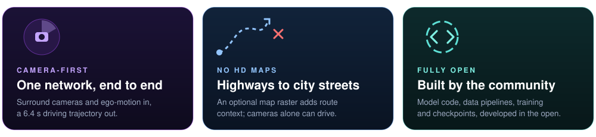
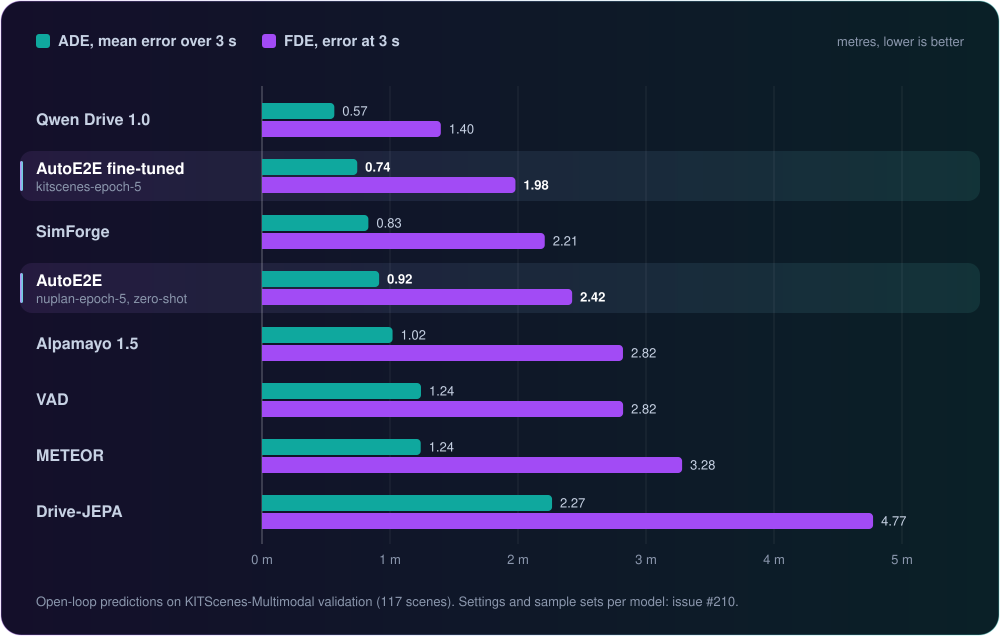

# AutoE2E - End-to-End AI for Self Driving

<p align="center">
    <picture>
        <source media="(prefers-color-scheme: dark)">
        
    </picture>
</p>

<p align="center">
  <a href="https://huggingface.co/AutowareFoundation/auto_e2e">
    
  </a>
</p>

<p align="center">
  <b>An open-source, camera-first End-to-End driving model for highways, arterial roads and city streets.</b>
</p>

<p align="center">
  <a href="https://huggingface.co/AutowareFoundation/auto_e2e"></a>
  <a href="https://github.com/autowarefoundation/auto_e2e/stargazers"></a>
  <a href="https://discord.com/invite/Q94UsPvReQ"></a>
  <a href="https://opensource.org/licenses/Apache-2.0"></a>
  
</p>

<br>

<p align="center">
  
</p>

AutoE2E plans the vehicle's trajectory directly from surround cameras. Fuse its output with LiDAR and radar safety layers for **driverless robotaxis**, or run it camera-only for **L2++ hands-free ADAS**.

<p align="center">
  
</p>


<p align="center">
  
</p>

AutoE2E is three cooperating models. The **Reactive model** runs at 10 Hz and drives: it lifts six surround cameras into a bird's-eye-view grid, optionally fuses a map raster, and lets a GRU planner turn that scene plus ego-motion history into the next 6.4 s of acceleration and curvature. The 1 Hz **World Action** and **Reasoning** models are in development. The [Model guide](./Model/) has the full inputs, outputs and forward signature.

<details>
  <summary>Original design diagram</summary>
  <br>
  
</details>


<p align="center">
  
  <br>
  <sub>KITScenes Epoch 5 entering a roundabout in Karlsruhe. <b>Purple</b> is the logged path, <b>green</b> is the AutoE2E prediction. Camera images: <a href="https://kitscenes.com/">KITScenes-Multimodal</a>, CC BY-NC 4.0.</sub>
</p>

<p align="center">
  <a href="https://d2itskdqq39tx1.cloudfront.net/"></a>
</p>

The read-only [DataModelConsole dashboard](https://d2itskdqq39tx1.cloudfront.net/) replays synchronized camera scenes with ground-truth and predicted trajectories in camera and bird's-eye views, next to dataset versions, MLflow models and Flyte executions.


<p align="center">
  
</p>

The fine-tuned AutoE2E checkpoint has the second-lowest error of the eight open-weights models compared here on KITScenes-Multimodal validation. Only Qwen Drive 1.0 is ahead, and AutoE2E beats SimForge, Alpamayo 1.5 and METEOR with 79.9 M parameters. All models are scored open-loop: each one predicts the next 3 s from logged camera frames, and the prediction is compared with the path the human driver took. ADE is the average position error over those 3 s and FDE is the error at the 3 s point.

| Model | Checkpoint / setting | Evaluated on | ADE @ 3 s (m) | FDE @ 3 s (m) |
|---|---|---|---:|---:|
| Qwen Drive 1.0 | first of 6 trajectories | 202 keyframes | 0.565 | 1.397 |
| **AutoE2E fine-tuned** | [`kitscenes-epoch-5`](https://huggingface.co/AutowareFoundation/auto_e2e/tree/main/models/kitscenes-epoch-5) | 202 keyframes | **0.744** | **1.980** |
| SimForge D1.5 | 7 camera slots (2 virtual telephoto), first of 6 trajectories | 202 keyframes | 0.831 | 2.209 |
| **AutoE2E** | [`nuplan-epoch-5`](https://huggingface.co/AutowareFoundation/auto_e2e/tree/main/models/nuplan-epoch-5), zero-shot | 11,035 samples | **0.915** | **2.423** |
| Alpamayo 1.5 | first of 6 trajectories | 202 keyframes | 1.020 | 2.820 |
| VAD | Base stage-2, oracle driving command | 11,035 samples | 1.242 | 2.821 |
| METEOR | top-1 of 3 paths | 202 keyframes | 1.240 | 3.282 |
| Drive-JEPA | perception-based v2, 20 m route command | 11,035 samples | 2.266 | 4.774 |

The 11,035 samples are every frame of the 117 validation scenes, and the 202 keyframes are non-overlapping anchors taken from the same scenes. Inputs differ by model: AutoE2E also gets an HD map and the route, and VAD and Drive-JEPA get a driving command. [Issue #210](https://github.com/autowarefoundation/auto_e2e/issues/210) has each model's adapter, ground truth and results at the other horizons.


**1. Install** with Python 3.12 (the pinned PyTorch build has no wheels for 3.13+).

```bash
git clone https://github.com/autowarefoundation/auto_e2e.git
cd auto_e2e
make setup                      # CPU torch wheels
make setup TORCH_CHANNEL=cu118  # or a CUDA build (cu126, cu128, ... work too)
make test                       # optional: verify the install
```

<details>
  <summary>No <code>make</code>? Use plain pip</summary>

```bash
pip install -r requirements.txt                      # CPU torch wheels
pip install -r requirements.txt --extra-index-url https://download.pytorch.org/whl/cu118  # or a CUDA build
```

The install check needs `make`, which you can get from a [package manager](https://chocolatey.org/).

</details>

**2. Pick a checkpoint** from the [Hugging Face release](https://huggingface.co/AutowareFoundation/auto_e2e). The model card has the loading example, the evaluation reports and the KITScenes validation shards.

| Checkpoint | Trained on | Use it for |
|---|---|---|
| [`nuplan-epoch-5`](https://huggingface.co/AutowareFoundation/auto_e2e/tree/main/models/nuplan-epoch-5) | nuPlan v1.1 | Zero-shot driving in new cities and fine-tuning on your data |
| [`kitscenes-epoch-5`](https://huggingface.co/AutowareFoundation/auto_e2e/tree/main/models/kitscenes-epoch-5) | nuPlan, then KITScenes-Multimodal | Karlsruhe roads and the KITScenes camera rig |

**3. Go further.** Read the [documentation and academic paper](https://autowarefoundation.github.io/auto_e2e/), explore the [Model](./Model/) folder, or follow the [Trial Guide](./TRIAL.md) to run the test suite on AWS EC2. Inference reaches up to **~76 FPS** (SwinV2-Tiny, feature-concat fusion, RTX 5080, batch 1); [BENCHMARKS.md](./Model/speed_benchmark/BENCHMARKS.md) has every GPU, backbone and batch size.


AutoE2E is developed in the Autoware Robotaxi working group, and new contributors are welcome. The [onboarding guide](./ONBOARDING.md) explains how to join the weekly meetings, and the community benchmark against other end-to-end models runs in [issue #210](https://github.com/autowarefoundation/auto_e2e/issues/210). If AutoE2E is useful to you, a ⭐ on GitHub helps the project grow.

<p align="center">
  <a href="https://discord.com/invite/Q94UsPvReQ"></a>
  <a href="https://huggingface.co/AutowareFoundation/auto_e2e"></a>
  <a href="https://www.linkedin.com/company/the-autoware-foundation"></a>
  <a href="https://www.youtube.com/@autowarefoundation"></a>
  <a href="https://autoware.org/"></a>
</p>

<p align="center">
  
</p>
